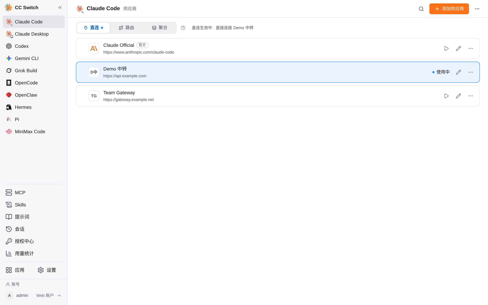
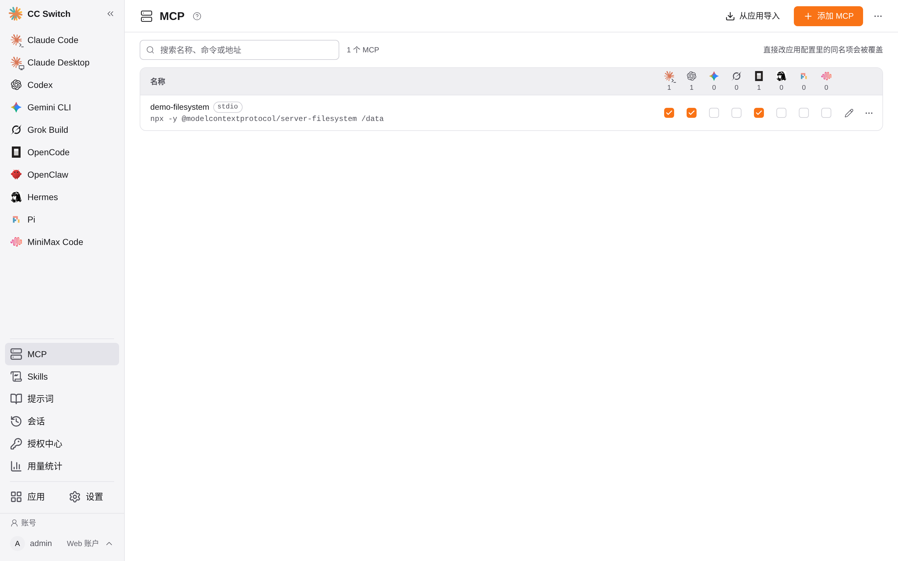
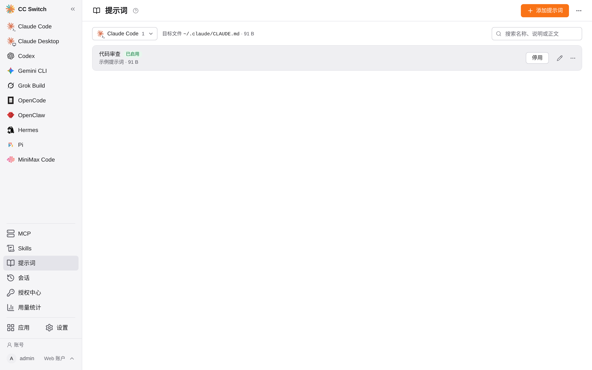
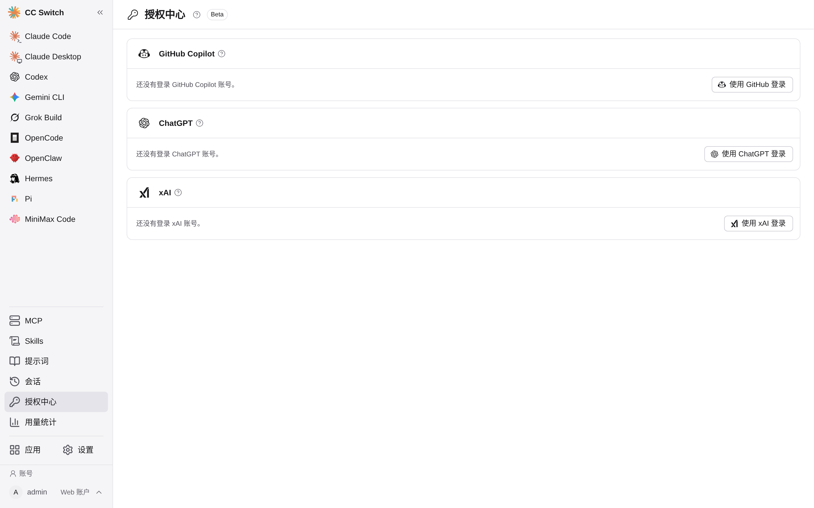
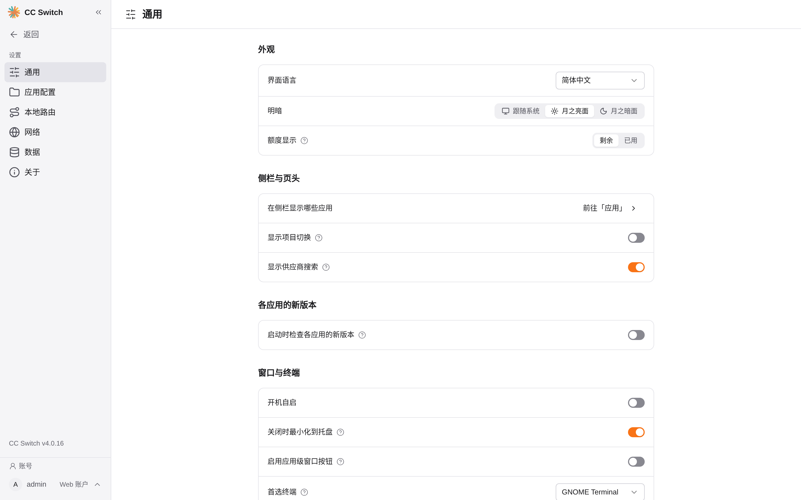
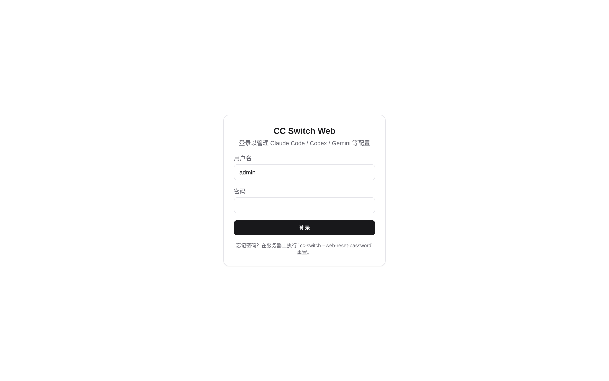
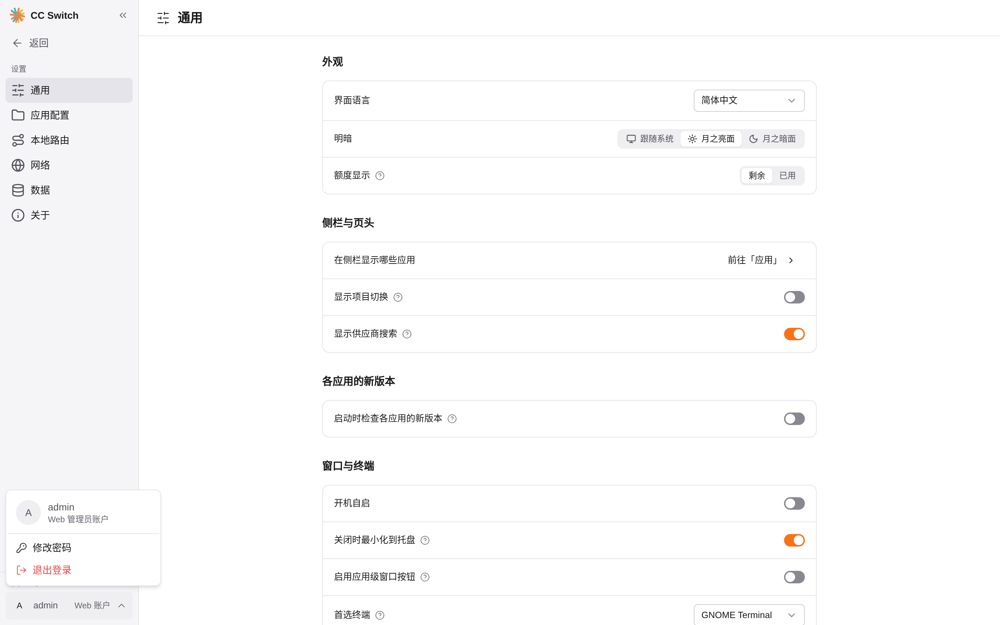

<div align="center">
  

  <h1>CC Switch Web</h1>

  <p><strong>给私有服务器用的 CC Switch Web 管理界面</strong><br/>
  不用 CLI/TUI · 浏览器管理 · 单管理员登录</p>

  <p>
    
    
    
    
  </p>

  <p>
    <a href="https://gitee.com/lian-haoxiong/cc-switch-web">Gitee</a>
    ·
    <a href="https://github.com/dowdsa/cc-switch-web">GitHub</a>
  </p>

  <p>
    <a href="../README.md"></a>
  </p>
</div>



> 截图使用演示数据，不包含真实密钥。

## 🎯 开发初衷

这是一个**个人自用**的二开项目，不是面向公网的产品：

- 官方提供的是桌面应用（服务器上则需要 CLI/TUI），我不想在服务器上使用 CLI/TUI
- 我的服务器**没有公网带宽**，也不打算把管理界面暴露到公网
- 因此把 CC Switch 的供应商与配置管理能力做成了 Web 界面：通过本机、内网或 SSH 隧道访问，配置和数据都留在服务器上

本项目 fork 自 **[farion1231/cc-switch](https://github.com/farion1231/cc-switch)**（基线 v4.0.16），不是官方 Web 版，与上游维护者没有隶属关系。

## ✨ 为什么选择 Web 版

CC Switch 原本是桌面应用。本项目把同一套供应商管理与路由能力搬到了浏览器里：

- **无图形界面的 Linux 服务器也能用**：一条命令部署，打开网址即可管理
- **完整的 CC Switch 能力**：不是简化版，供应商、路由、MCP、Skills、提示词、会话、用量全部保留
- **面向服务器场景**：单管理员登录、改密、会话失效、登录限流、CSRF 防护
- **数据与桌面版一致**：直接读写 `~/.claude`、`~/.codex` 等配置与同一份 SQLite 数据库
- **一键部署与升级**：`deploy/install.sh` 自动构建并注册 systemd 服务

## 🚀 功能一览

### 供应商与路由

- 新增 / 编辑 / 删除 / 排序 / 一键切换供应商
- 直连、路由、聚合三种模式；代理接管与热切换
- 自动故障转移、熔断器、健康检查、端点测速
- 官方供应商预设与统一供应商（Universal Provider）
- Claude Desktop / Codex / Gemini / Grok / OpenCode / OpenClaw / Hermes / Pi / MiniMax Code 全覆盖

### MCP · Skills · 提示词

- 统一 MCP 管理：一处维护，按应用开关自动同步到各 CLI
- Skills 仓库、安装、更新、备份与多应用启用
- 提示词库：编辑、启用停用、写入 `CLAUDE.md` 等目标文件
- 项目 Profile：整套配置快照一键应用

### 会话与用量

- 浏览、搜索、导出各 CLI 的会话记录，支持大文件流式读取
- 请求日志、Token/费用统计、按供应商与模型聚合
- 订阅额度（Claude / Codex / Copilot / xAI / 编码套餐）与余额查询

### 账号、同步与安全

- 授权中心：GitHub Copilot / ChatGPT / xAI OAuth 设备码登录与多账号管理
- WebDAV / S3 同步、数据库备份、SQL 导入导出
- 单管理员账号：Argon2id 哈希、服务端会话、改密后旧会话全部失效；账号入口固定在左侧栏底部，点击向上弹出账户菜单
- 只监听回环的默认部署、一次性初始化令牌、登录限流、CSRF 校验

## 🧩 支持的 CLI 工具

| 工具 | 管理内容 |
| --- | --- |
| Claude Code | 供应商切换、MCP、提示词、会话、用量 |
| Claude Desktop | 官方/中转配置、模型路由 |
| Codex | 供应商、认证、聚合模型、会话与用量 |
| Gemini CLI | 供应商、MCP、会话 |
| Grok Build | 供应商与官方登录 |
| OpenCode | 供应商、默认模型、MCP |
| OpenClaw | 供应商、Agents/Env/Tools、工作区文件 |
| Hermes | 供应商、模型、记忆文件 |
| Pi | 供应商、模型、提示词文件、会话 |
| MiniMax Code | 供应商管理 |

## 🖥 界面预览

| MCP 统一管理 | 提示词库 |
| --- | --- |
|  |  |

| 授权中心 | 系统设置 |
| --- | --- |
|  |  |

| 登录页 | 账户菜单 |
| --- | --- |
|  |  |

## 📦 快速开始

环境要求：Linux x64、Node.js 20+、Rust（以 `rust-toolchain.toml` 为准）、GTK/WebKit 依赖。完整说明见 [DEPLOY.md](../DEPLOY.md)。

```bash
# Gitee
git clone git@gitee.com:lian-haoxiong/cc-switch-web.git
# 或 GitHub
# git clone https://github.com/dowdsa/cc-switch-web.git

cd cc-switch-web

# 默认仅监听 127.0.0.1:8787（推荐配合 SSH 隧道或 Nginx HTTPS）
sudo bash deploy/install.sh

# 内网直接访问
sudo HOST=0.0.0.0 PORT=8787 \
  ALLOWED_ORIGINS=http://<服务器IP>:8787 \
  bash deploy/install.sh
```

首次启动会生成一次性初始化令牌，用它创建管理员账号：

```bash
cat ~/.cc-switch/web/setup-token
```

服务管理：

```bash
systemctl status cc-switch-web
systemctl restart cc-switch-web
journalctl -u cc-switch-web -f
```

升级：`git pull && sudo bash deploy/install.sh`，数据库与登录状态保留。

## 🏗 架构

```text
浏览器 (React SPA, Vite)
   │  /api/rpc · SSE · NDJSON 流 · 上传/下载
   ▼
Rust axum 服务（cargo feature "web"）
   │  复用 CC Switch services / database / proxy
   ▼
~/.cc-switch/cc-switch.db   +   ~/.claude、~/.codex 等 CLI 配置
~/.cc-switch/web/auth.db（独立认证库）
```

桌面专属能力（托盘、自动更新、原生文件对话框等）在 Web 端隐藏或替换，差异与上游合并说明见 [patches.md](../patches.md)。

## 🔒 安全提醒

Web 端拥有管理服务器 CLI 配置的能力，部分操作等价于服务用户权限。请：

- 默认保持只监听 `127.0.0.1`，通过 SSH 隧道或 Nginx/Caddy HTTPS 访问
- 不要直接暴露到公网；反向代理示例见 [deploy/nginx.conf.example](../deploy/nginx.conf.example)
- 服务以哪个用户运行，就管理哪个用户的 `~/.claude` 等配置

## 📚 文档

- [DEPLOY.md](../DEPLOY.md)：部署、升级、同步上游、发布快照
- [patches.md](../patches.md)：相对上游的改动清单
- `scripts/sync-upstream.sh`：同步上游 release
- `scripts/publish-repos.sh`：发布 Gitee / GitHub 单提交快照

## 🙏 上游仓库与许可

- 上游项目：**CC Switch**
- 上游仓库：**https://github.com/farion1231/cc-switch**
- 基线版本：v4.0.16
- 上游作者：Jason Young

本项目为社区二开，不是官方 Web 版，与上游维护者没有隶属关系。代码与数据库结构沿用上游，Web 界面、登录认证、部署脚本等为本仓库新增。

Based on [farion1231/cc-switch](https://github.com/farion1231/cc-switch), Copyright (c) Jason Young, licensed under the MIT License.

本项目保留上游代码与版权声明，Web 二开部分按同一许可证发布。详见 [LICENSE](../LICENSE)。
